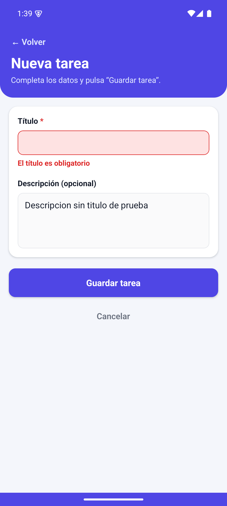

# TaskFlow Mobile – Automatización de recorridos móviles con Maestro

Proyecto final de **Ingeniería en Sistemas – Universidad Mariano Gálvez de Guatemala**.
Estudiante: **Javier Alejandro Guerra Zepeda**.

Aplicación Android **TaskFlow Mobile – Gestor de Tareas** y tres recorridos automatizados con
[Maestro](https://docs.maestro.dev/), ejecutados en un emulador Android real, con registros,
reportes JUnit, capturas auténticas e informe PDF.

| Entregable | Ubicación |
|---|---|
| Código de la app | [`app/`](app/) |
| APK instalable | [TaskFlowMobile-1.0.0.apk (Release v1.0.0)](https://github.com/javier2002guerra-lab/Automatizaci-n-de-recorridos-m-viles-con-Maestro/releases/download/v1.0.0/TaskFlowMobile-1.0.0.apk) |
| Flujos Maestro (YAML) | [`maestro/`](maestro/) |
| Capturas de las pruebas | [`evidencias/`](evidencias/) |
| Registros y reportes JUnit | [`resultados/`](resultados/) |
| Informe PDF | [`informe/Informe-Final-Maestro.pdf`](informe/Informe-Final-Maestro.pdf) |

---

## 1. Descripción de la aplicación

TaskFlow Mobile permite gestionar tareas personales desde el teléfono:

- Pantalla principal con el listado de tareas y un contador de pendientes y completadas.
- Formulario de nueva tarea: **título obligatorio** (máx. 80 caracteres) y **descripción opcional**.
- Validación: con el título vacío (o solo espacios) se muestra **«El título es obligatorio»** y no se guarda nada.
- Confirmación **«Tarea guardada correctamente»** después de guardar.
- Marcar o desmarcar una tarea como **completada** (insignia «Pendiente» / «Completada» y texto tachado).
- **Persistencia local** con AsyncStorage: las tareas siguen ahí al cerrar y reabrir la app.
- Navegación entre listado y formulario con «Volver», «Cancelar» y el botón atrás de Android; el formulario se ajusta al teclado (`softwareKeyboardLayoutMode: resize`).
- Interfaz en español.

**Sin backend.** Todos los datos se guardan en el almacenamiento privado de la app en el dispositivo
(clave `@taskflow/tareas` de AsyncStorage). La app no depende de servicios externos ni de Internet.

| Dato | Valor |
|---|---|
| Identificador Android (`applicationId` / `appId` de Maestro) | `gt.edu.umg.taskflow` |
| Versión | `1.0.0` (versionName) – versionCode `1` |
| Tipo de compilación | APK *release* con el JS empaquetado (Hermes); **no** usa Expo Go ni Metro |

### Identificadores para Maestro (`testID`)

| testID | Elemento |
|---|---|
| `titulo-pantalla-principal` | Título «Mis tareas» |
| `resumen-tareas` | Contador «N pendientes · M completadas» |
| `lista-vacia` | Mensaje «Aún no tienes tareas» |
| `btn-nueva-tarea` | Botón «＋ Nueva tarea» |
| `mensaje-confirmacion` | Aviso «Tarea guardada correctamente» |
| `titulo-formulario` | Título «Nueva tarea» |
| `input-titulo`, `input-descripcion` | Campos del formulario |
| `error-titulo` | Mensaje «El título es obligatorio» |
| `btn-guardar`, `btn-cancelar`, `btn-volver` | Botones del formulario |
| `titulo-<título>`, `estado-<título>`, `check-<título>` | Título, insignia de estado y casilla de cada tarea |

## 2. Objetivo de las pruebas

Comprobar con Maestro, sobre el APK instalado, tres recorridos de usuario:

1. **Registro exitoso** de una tarea.
2. **Validación** del título obligatorio, sin crear registros inválidos.
3. **Persistencia**: la tarea sobrevive a cerrar y reabrir la app y su estado «Completada» se guarda.

## 3. Tecnologías y versiones exactas

Versiones registradas en [`resultados/entorno/versiones-entorno.txt`](resultados/entorno/versiones-entorno.txt).

| Herramienta | Versión |
|---|---|
| Sistema operativo | Windows 11 Home Single Language 10.0.26200 (64 bits) |
| Node.js | v22.23.4 (portable, usada para compilar; Expo SDK 58 exige ≥ 22.13) · v22.10.0 en el sistema |
| npm | 10.9.0 |
| Expo SDK / Expo CLI | 58.0.22 / 58.1.18 |
| React Native / React | 0.88.1 / 19.3.0 |
| TypeScript | 6.0.x |
| AsyncStorage | @react-native-async-storage/async-storage 2.2.0 |
| Java | Oracle JDK 21.0.1 |
| Gradle | 9.4.1 (wrapper) |
| Android SDK | platform-tools (ADB 1.0.41 / 37.0.1), build-tools 35/36, platform android-35 |
| Android Emulator | 37.2.13.0, aceleración WHPX |
| Maestro CLI | 2.12.0 |

## 4. Plataforma Android probada

| Dato | Valor |
|---|---|
| Tipo | Emulador oficial del Android SDK |
| AVD | `TaskFlow_API35`, perfil **Pixel 6** |
| Android | **15 (API 35)**, imagen `google_apis` **x86_64** |
| Pantalla | 1080 × 2400, 420 dpi |
| RAM del AVD | 2 GB, teclado en pantalla activado (`hw.keyboard = no`) |
| Serial ADB | `emulator-5554` (modelo `sdk_gphone64_x86_64`) |

No se probó en dispositivos físicos ni en otras versiones de Android.

## 5. Descargar el código e instalar dependencias

```powershell
git clone https://github.com/javier2002guerra-lab/Automatizaci-n-de-recorridos-m-viles-con-Maestro.git C:\tfm
cd C:\tfm\app
npm ci
```

> Se recomienda una ruta corta y sin espacios ni tildes (por ejemplo `C:\tfm`): en Windows, CMake/Gradle
> fallan con rutas largas al compilar los módulos nativos de React Native.

Requisitos: Node.js ≥ 22.13, JDK 17+ (se usó 21), Android SDK con `platform-tools` y `emulator`,
y la variable `ANDROID_HOME` apuntando al SDK.

## 6. Compilar la aplicación

```powershell
powershell -ExecutionPolicy Bypass -File scripts\compilar-apk.ps1
```

El script ejecuta `npx expo prebuild --platform android --clean` (genera `app/android/` a partir de
`app.json`) y `gradlew assembleRelease -PreactNativeArchitectures=arm64-v8a,x86_64`. El resultado se copia a
`build\TaskFlowMobile-1.0.0.apk`. Registro de la compilación real:
[`resultados/compilacion/compilacion-apk.log`](resultados/compilacion/compilacion-apk.log).

## 7. Descargar e instalar el APK

**Descarga directa:** [TaskFlowMobile-1.0.0.apk (Release v1.0.0)](https://github.com/javier2002guerra-lab/Automatizaci-n-de-recorridos-m-viles-con-Maestro/releases/download/v1.0.0/TaskFlowMobile-1.0.0.apk)

```powershell
adb install -r TaskFlowMobile-1.0.0.apk
# o bien
powershell -ExecutionPolicy Bypass -File scripts\instalar-apk.ps1 -Apk build\TaskFlowMobile-1.0.0.apk
```

Verificación del paquete y la versión instalada:

```powershell
adb shell dumpsys package gt.edu.umg.taskflow | Select-String "versionCode=|versionName="
```

## 8. Preparación de datos y limpieza

- **Cada escenario se prepara solo.** Los tres empiezan con `runFlow: helpers/iniciar-limpio.yaml`, que
  abre la app con `launchApp` + `clearState: true` y verifica que el listado está vacío
  («Aún no tienes tareas», «0 pendientes · 0 completadas»).
- `clearState` borra **solo** los datos del paquete `gt.edu.umg.taskflow` en el emulador de pruebas
  (equivale a «Borrar datos» en Ajustes). La app no tiene ninguna función oculta de reinicio.
- **Escenario 03:** la limpieza se hace una sola vez, al inicio. Las reaperturas usan `stopApp` y
  `launchApp` con `clearState: false`, para que los datos de AsyncStorage se conserven.
- Los datos de prueba (títulos/descripciones) están en el bloque `env` de cada YAML. Se escriben sin tildes
  por precaución (la escritura de caracteres no ASCII con `inputText` en Android puede no ser fiable; no se probó).
- Limpieza manual opcional: `powershell -File scripts\limpiar-datos.ps1` (`adb shell pm clear gt.edu.umg.taskflow`).

## 9. Escenarios de Maestro

| Archivo | Qué comprueba |
|---|---|
| [`maestro/01-registro-exitoso.yaml`](maestro/01-registro-exitoso.yaml) | Abre la app limpia, verifica la pantalla principal, abre el formulario, escribe título y descripción, guarda y verifica la confirmación, el título, la descripción, el estado «Pendiente» y el contador. |
| [`maestro/02-validacion-entrada.yaml`](maestro/02-validacion-entrada.yaml) | Con el título vacío (y luego solo espacios) pulsa guardar: verifica «El título es obligatorio», que no hay confirmación, que sigue en el formulario y, tras cancelar, que el listado sigue vacío y la descripción no aparece. |
| [`maestro/03-persistencia-reapertura.yaml`](maestro/03-persistencia-reapertura.yaml) | Crea una tarea, cierra la app (`stopApp`), la reabre sin borrar datos, verifica que la tarea sigue, la marca como completada, verifica el cambio y comprueba que «Completada» se conserva tras otra reapertura. |
| [`maestro/helpers/`](maestro/helpers/) | `iniciar-limpio.yaml` (estado inicial controlado) y `crear-tarea.yaml` (alta de una tarea). |
| [`maestro/config.yaml`](maestro/config.yaml) | Al ejecutar la carpeta, corre solo los tres escenarios y en orden. |

Los flujos usan `testID` estables (`id:`), `inputText`, `assertVisible` / `assertNotVisible`,
`extendedWaitUntil` como espera condicionada (sin pausas fijas ni coordenadas), `takeScreenshot`,
`stopApp` y `launchApp`.

### Ejecutar cada escenario

Con el emulador iniciado y la app instalada:

```powershell
maestro test maestro/01-registro-exitoso.yaml
maestro test maestro/02-validacion-entrada.yaml
maestro test maestro/03-persistencia-reapertura.yaml
```

### Ejecutar los tres escenarios juntos

```powershell
maestro test maestro
```

### Ejecución con registros, JUnit y capturas (como se hizo en esta entrega)

```powershell
powershell -ExecutionPolicy Bypass -File scripts\ejecutar-pruebas.ps1 -Escenario 01   # 02, 03 o conjunta
```

Guarda la salida de la terminal y el código de salida en `resultados/ejecuciones/<ejecución>-<fecha>/`,
el reporte en `resultados/reportes/<ejecución>-junit.xml` y copia las capturas a `evidencias/`.
`scripts\ejecutar-con-captura-terminal.ps1 -Escenario 01` hace lo mismo dentro de una ventana de
PowerShell visible y guarda una imagen de esa ventana (`evidencias/<carpeta>/terminal-*.png`).

## 10. Resultados reales

Ejecutados el **2026-10-31** en `emulator-5554` (Pixel 6, Android 15, API 35) con Maestro 2.12.0 sobre el
APK 1.0.0 instalado (SHA-256 `51D38B35FFB085B16BAD725791BC9A7C811E485F837CF49BF9396E6870C80904`).

| Ejecución | Inicio (-06:00) | Resultado Maestro | Código de salida | Registro | Reporte JUnit |
|---|---|---|---|---|---|
| Escenario 01 | 19:36:44 | `[Passed]` 1/1 (51 s) | 0 | [log](resultados/ejecuciones/escenario-01-20261031-193643/salida-terminal.log) | [xml](resultados/reportes/escenario-01-junit.xml) |
| Escenario 02 | 19:38:27 | `[Passed]` 1/1 (52 s) | 0 | [log](resultados/ejecuciones/escenario-02-20261031-193827/salida-terminal.log) | [xml](resultados/reportes/escenario-02-junit.xml) |
| Escenario 03 | 19:40:05 | `[Passed]` 1/1 (1 m 1 s) | 0 | [log](resultados/ejecuciones/escenario-03-20261031-194005/salida-terminal.log) | [xml](resultados/reportes/escenario-03-junit.xml) |
| **Conjunta (01+02+03)** | 19:41:51 | `3/3 Flows Passed in 2m 32s` | 0 | [log](resultados/ejecuciones/ejecucion-conjunta-20261031-194151/salida-terminal.log) | [xml](resultados/reportes/ejecucion-conjunta-junit.xml) |

- **Resultado: 3 de 3 escenarios aprobados individualmente y 3 de 3 en la ejecución conjunta.**
- Cada carpeta de `resultados/ejecuciones/` contiene `salida-terminal.log`, `resumen.json` y la salida original de
  Maestro (`maestro/.../commands.json`, `logs/maestro.log`, `logs/device-logcat.txt`, capturas).
- [`resultados/resumen-comandos-maestro.txt`](resultados/resumen-comandos-maestro.txt): en los 7 `commands.json`
  (uno por flujo ejecutado) todos los comandos terminaron en estado `COMPLETED` (36, 41 y 45 comandos por flujo,
  con unas 20 aserciones/esperas cada uno).
- Hubo una primera ejecución del escenario 01 (`escenario-01-20261031-193356`), también aprobada con código 0. Se repitió
  solo para corregir la codificación del registro (salía en UTF-16 mezclado) y obtener la captura de la terminal; se conserva tal cual.
- Instalación verificada: [`resultados/compilacion/instalacion-apk.log`](resultados/compilacion/instalacion-apk.log)
  (`Success`, versionCode 1, versionName 1.0.0, app en primer plano sin Metro escuchando en el puerto 8081).

## 11. Capturas

Todas las capturas del dispositivo se tomaron con `takeScreenshot` de Maestro durante las ejecuciones; las de
terminal son imágenes de la ventana real de PowerShell donde corrió cada ejecución
([`scripts/ejecutar-con-captura-terminal.ps1`](scripts/ejecutar-con-captura-terminal.ps1)).

| Escenario | Capturas del emulador | Terminal |
|---|---|---|
| 01 | [pantalla inicial](evidencias/escenario-01/escenario-01_01_pantalla-inicial.png) · [formulario completado](evidencias/escenario-01/escenario-01_02_formulario-completado.png) · [confirmación y tarea creada](evidencias/escenario-01/escenario-01_03_confirmacion-y-tarea-creada.png) | [terminal](evidencias/escenario-01/terminal-escenario-01.png) |
| 02 | [título vacío](evidencias/escenario-02/escenario-02_01_formulario-titulo-vacio.png) · [mensaje de validación](evidencias/escenario-02/escenario-02_02_mensaje-validacion.png) · [estado tras el rechazo](evidencias/escenario-02/escenario-02_03_estado-posterior-rechazo.png) | [terminal](evidencias/escenario-02/terminal-escenario-02.png) |
| 03 | [antes del cierre](evidencias/escenario-03/escenario-03_01_tarea-creada-antes-del-cierre.png) · [tras reabrir](evidencias/escenario-03/escenario-03_02_app-reabierta-tarea-conservada.png) · [completada](evidencias/escenario-03/escenario-03_03_tarea-completada.png) · [tras 2.ª reapertura](evidencias/escenario-03/escenario-03_04_completada-tras-segunda-reapertura.png) | [terminal](evidencias/escenario-03/terminal-escenario-03.png) |
| Conjunta | [10 capturas](evidencias/ejecucion-conjunta/) | [terminal](evidencias/ejecucion-conjunta/terminal-ejecucion-conjunta.png) |

<p>



</p>

## 12. Informe PDF

[`informe/Informe-Final-Maestro.pdf`](informe/Informe-Final-Maestro.pdf) — generado con
[`informe/generar-informe.py`](informe/generar-informe.py) a partir de los registros y capturas de este repositorio.

## 13. Commit de entrega

- **Código probado y evidencias:** commit [`5ee32f0`](https://github.com/javier2002guerra-lab/Automatizaci-n-de-recorridos-m-viles-con-Maestro/commit/5ee32f03b67ccbf163f5c378d44f20f6cfbdd02f) — es el commit sobre el que se creó la
  Release [`v1.0.0`](https://github.com/javier2002guerra-lab/Automatizaci-n-de-recorridos-m-viles-con-Maestro/releases/tag/v1.0.0) y el que cita el informe PDF.
- **Commit de entrega:** el commit siguiente solo agrega este README y el informe PDF (no cambia código, flujos ni
  evidencias). Su SHA es el último de la rama [`main`](https://github.com/javier2002guerra-lab/Automatizaci-n-de-recorridos-m-viles-con-Maestro/commits/main).

## 14. Limitaciones conocidas

- Solo se probó en el emulador descrito (Android 15, API 35, x86_64); no en dispositivos físicos, otras versiones de Android ni iOS.
- El APK incluye las arquitecturas `arm64-v8a` y `x86_64` (no `armeabi-v7a` ni `x86`).
- El APK *release* está firmado con la clave de depuración que genera Expo: se instala directamente con ADB, pero no sirve para publicar en Google Play.
- `app/android/` no se versiona; se regenera con `expo prebuild` a partir de `app.json`.
- Los datos que teclea Maestro no llevan tildes, por precaución; no se probó la entrada de texto acentuado con `inputText`. Los textos de la interfaz y las aserciones sí llevan tildes.

## Estructura del repositorio

```text
app/                 Código fuente (Expo + React Native + TypeScript)
maestro/             Escenarios 01–03, helpers/ y config.yaml
scripts/             Compilar, instalar, ejecutar pruebas, limpiar datos, generar iconos
evidencias/          Capturas reales por escenario y de la ejecución conjunta
resultados/          entorno/, compilacion/, ejecuciones/ (logs + resumen.json), reportes/ (JUnit)
informe/             Informe-Final-Maestro.pdf y su generador
```

Licencia: [MIT](LICENSE).
